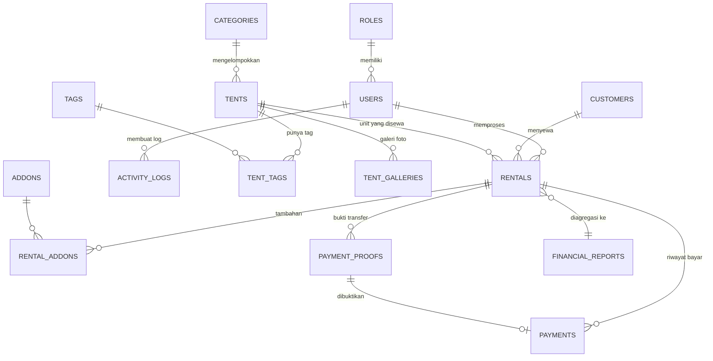

# ERD — Teduh Alam (teduhalam.id)

Diagram relasi entitas (Mermaid — render otomatis di GitHub/VS Code):



## Ringkasan Relasi Utama

| Relasi | Kardinalitas | Penjelasan dari kode |
|---|---|---|
| categories → tents | 1:N | `category: "4 Orang"` pada state.tents & filter `catalogFilter` |
| tents ↔ tags | M:N | array `tags[]` (Double Layer, Waterproof 3000mm, dst.) |
| tents → tent_galleries | 1:N | array `gallery[]` (Tampak Depan, Interior, Detail Jahitan, Suasana Malam) |
| customers → rentals | 1:N | data customer/phone/email pada order & submitBookingOrder |
| tents → rentals | 1:N | satu tenda disewa banyak transaksi; stok dihitung dari rentals aktif |
| rentals → rental_addons | 1:N | `addonCounts {matras, sb, kompor}` dengan snapshot harga/malam |
| rentals → payment_proofs | 1:N | upload bukti transfer DP (`receiptDataUrl`) + verifikasi admin |
| rentals → payments | 1:N | DP lalu pelunasan (verifyOrderDP → markOrderPaid), mendukung refund |
| users → activity_logs | 1:N | feed dashboard `state.activities` (audit trail semua aksi admin) |

## Lifecycle Status Pesanan (gabungan dpStatus app.js + stage HalPemesanan.html)

```
[Menunggu Verifikasi DP] --(admin: verifyOrderDP)--> [DP Terverifikasi]
        --> [Unit Siap] --(serah terima/pelunasan)--> [Lunas] --> [Selesai]
        (cabang mana saja) --(batal/refund)--> [Dibatalkan]
```

## Standar Industri yang Diterapkan

1. **Normalisasi 3NF** — master data (tents, addons, customers) terpisah dari transaksi; M:N dipecah via tabel junction (tent_tags, rental_addons).
2. **InnoDB + FK constraint** — `RESTRICT` untuk data transaksi (tidak bisa menghapus tenda yang pernah disewa), `CASCADE` untuk data dependen (tags/galeri/item add-on), `SET NULL` untuk referensi user pada log.
3. **Tipe uang = DECIMAL(12,2)** — bukan FLOAT/DOUBLE, menghindari error pembulatan rupiah.
4. **Price snapshot** — harga tersimpan di baris transaksi agar laporan historis tidak berubah saat tarif naik.
5. **Generated column** — `nights` dihitung DB dari tanggal check-in/out (satu sumber kebenaran).
6. **Soft delete** — `deleted_at` pada tents; histori transaksi tetap utuh.
7. **Audit columns** — `created_at`, `updated_at` di semua tabel + `activity_logs` sebagai audit trail.
8. **Indexed for query patterns** — status pesanan, rentang tanggal sewa (cek bentrok jadwal), fulltext pencarian katalog, agregasi laporan per tanggal bayar.
9. **Views** — `v_tent_availability` (stok siap sewa real-time) dan `v_rental_summary` (tabel verifikasi DP admin) menggantikan perhitungan manual di JS.
10. **Password/PIN di-hash** — kolom `password_hash`/`pin_hash` (bcrypt/argon2), tidak ada kredensial plaintext seperti di demo login.html.
